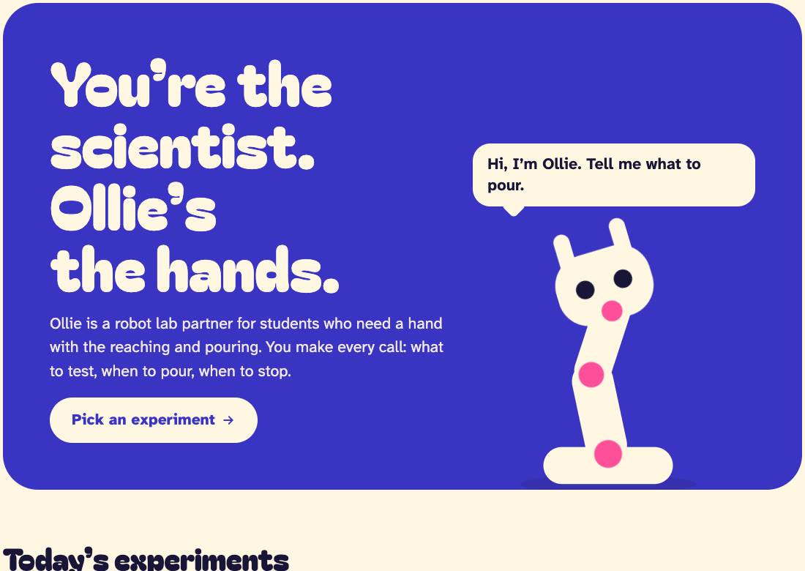
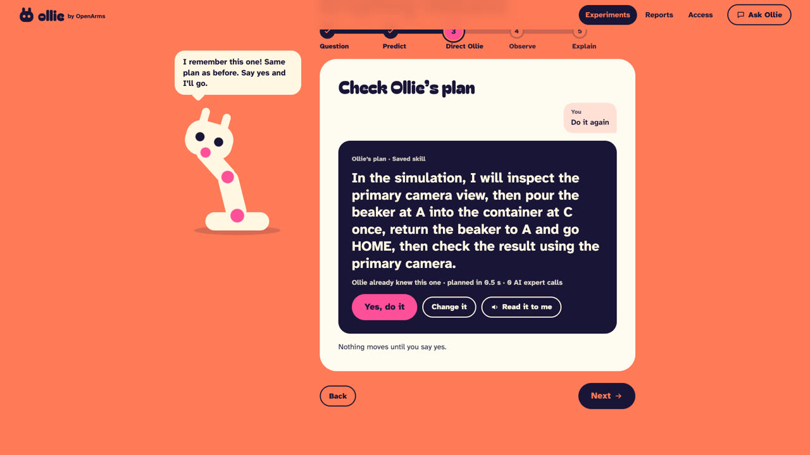
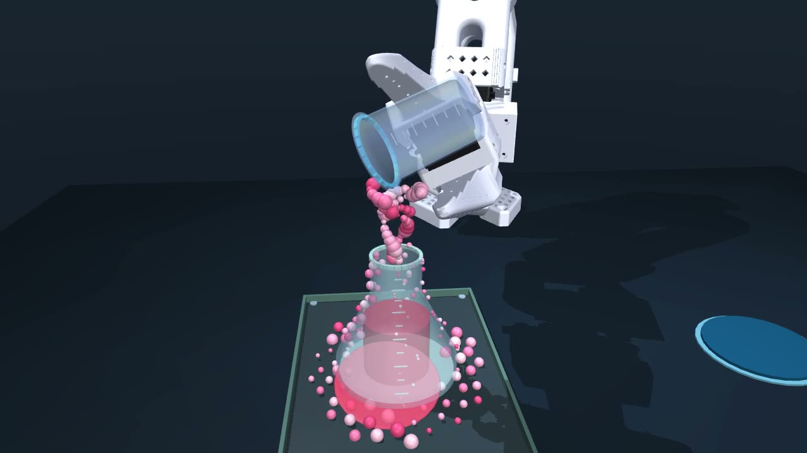
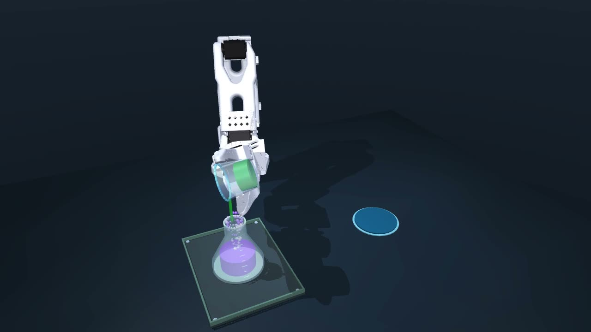

# OpenArms · Ollie

**You're the scientist. Ollie's the hands.**

Ollie is a robot lab partner for students who can't hold the beaker. The student talks; Ollie looks at the bench, plans from moves tested on a real arm, says its plan and waits for a yes. A camera then checks what actually happened, and the student decides what to test next. Every task Ollie gets right becomes a saved skill, so the next time is a single tool call.

Built at HackPrinceton Fall 2026 by Victor Jimenez, Duc Duong, Joseph Roche and Stefanie Nguyen.



## Why

One in five US undergraduates reports a disability, and only 8% register one with their college ([NCES](https://nces.ed.gov/fastfacts/display.asp?id=60), [PNPI](https://pnpi.org/wp-content/uploads/2026/02/PNPI_StudentswithDisabilities_FactSheet_Jan26.pdf)). In a national survey of students with physical disabilities, about half had been given passive roles in science labs and three in four relied on classmates to finish lab tasks ([Jeannis et al., 2019](https://www.tandfonline.com/doi/full/10.1080/17483107.2018.1559889)). When someone else has the hands, they usually make the calls too. Ollie gives the calls back to the student. [More evidence and its limits](research/victor/accessibility-market-validation.md).

## How a lab runs

**Question → Predict → Direct Ollie → Observe → Explain.**

1. The student asks in their own words: "Ollie, pour beaker A into flask C." Voice, typing, a switch, eye gaze or voice control all work.
2. A vision-capable expert model checks a fresh camera frame and composes a plan from a fixed set of typed, tested actions.
3. Ollie states the exact plan. Nothing moves until the student confirms that exact version. Stop always wins.
4. A deterministic executor runs the bounded action on the SO-101 arm (or its simulation).
5. An independent observer reads fresh pixels and reports what happened, or says "unknown".
6. A plan that succeeds is replayed by an evaluator on the normal case, six fault cases, the consent check and the Stop check, then saved as a skill for that exact setup.



In Duc's logged bench run, reusing a saved skill cut request-to-plan from **58.8 s to 0.41 s** and model calls for the run from **6 to 0**, with consent and the camera check still in place ([evidence](research/duc/demo-bench-integration.md)).

## What's in the box

| Part | What it does | Where |
| --- | --- | --- |
| Agent runtime | One session and task loop: Gemini Live conversation, separate expert planner, exact proposals and consent, deterministic executor, independent observer, skill registry and evaluator | `agentic/` |
| Student app | Ollie: guided labs, accessible by keyboard, switch, eye gaze and voice control; reports and Ask Ollie | `ui/student/` (served at `/student`; arriving from `victor/user-flow-ui`) |
| Developer view | The same session with expert/tool traces, observations, skill evaluations and simulator frames | `ui/lab/` (served at `/developer`) |
| Hardware | SO-101 arm on LeRobot, calibration, recorded pours, overhead camera localization, base plate with ArUco markers | `firmware/`, `firmware/fixtures/cup_dock/` |
| Simulation | MuJoCo model of the same arm and bench, lined up with a real recorded pour; Smartivity kit experiments | `simulation/` |
| iPhone voice | SwiftUI client sharing the same session | `research/joseph/iphone-voice-bridge/` |

| | |
| --- | --- |
|  |  |
| *Erupting Volcano · simulation* | *Magic Potions · simulation* |

## Run it

Python 3.12 and [uv](https://docs.astral.sh/uv/). The simulation backend needs no hardware.

```sh
uv venv --python 3.12 .venv-lab
uv pip install --python .venv-lab/bin/python -r agentic/requirements-lab.txt -e 'simulation[dev]'
OPENARMS_EXECUTION=mujoco PORT=8010 .venv-lab/bin/python -m agentic.openarms_lab
```

Open `http://127.0.0.1:8010/student/` for Ollie and `/developer` for the traces. Put `GEMINI_API_KEY` in an untracked `.env` for voice, and sign in to the expert CLI you choose ([model profiles](docs/EXPERT_MODELS.md)). The real bench, camera and arm options are in [the runbook](docs/LAB_RUNBOOK.md); every physical motion needs an operator at the arm.

Tests:

```sh
PYTHONPATH=agentic:simulation:. .venv-lab/bin/python -m pytest agentic/tests simulation/tests --import-mode=importlib -o asyncio_mode=auto -q
```

## What is real and what is simulated

- The arm, fixture, camera and recorded pour are real. Motion on the arm always runs under an operator.
- Experiments marked **Simulation** are MuJoCo models; their reactions are illustrative, not measured chemistry.
- Timings above are from the simulator backend.
- We have not yet tested with students with disabilities or measured learning. That pilot is the next step.

## Credits

[Hugging Face LeRobot](https://github.com/huggingface/lerobot) and [The Robot Studio SO-101](https://github.com/TheRobotStudio/SO-ARM100), [MuJoCo](https://mujoco.org), Google Gemini Live, OpenAI Codex, Anthropic Claude, Devin, FastAPI, OpenCV. Experiments adapted from Smartivity's *My First Science Kit*. Fonts: Bagel Fat One and Atkinson Hyperlegible Next (SIL Open Font License).

## For the team

Start with [the architecture](docs/ARCHITECTURE.md), the [project brief](docs/PROJECT.md), [interfaces](docs/INTERFACES.md), [current tasks](research/joseph/TODO.md) and the [integration ledger](docs/MAIN_INTEGRATION.md). Work in your own worktree and branch; check the [ownership table](AGENTS.md#ownership) first. Pitch and submission (everything is in [`pitch/`](pitch/)): [film plan](pitch/FILM.md), [team directives](pitch/TEAM.md), [facts and sources](pitch/FACTS.md), [Devpost copy](research/victor/hackprinceton-devpost-draft.md).
