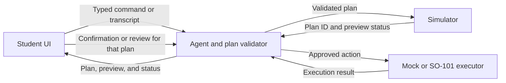

# OpenArms architecture

OpenArms lets a student direct a physical lab action by voice, preview it in simulation, and confirm it before the arm moves. The first shared test is a proposed fixed-station block transfer. The red-cabbage pH demo is a candidate for judging, pending bench trials. [Project brief](PROJECT.md) · [Team architecture brief](https://app.notion.com/p/41771c9c107e8141bba0d7beb491601b) · [Demo runbook](https://app.notion.com/p/41771c9c107e81ab8026cdafa6245063)

## Command flow

| Component | Owns |
| --- | --- |
| UI · Victor | Accepts the command and displays the interpreted action, destination, preview, instructor feedback, and run status. Sends confirmation or review for the displayed plan. [UI architecture draft](https://github.com/VictorJimenez3/OpenArms/pull/6) |
| Agentic · Duc | Resolves a command to a supported action and named stations, validates it, and tracks its plan ID through preview, confirmation, review, and execution. Enforces the rules for dispatching motion. [Draft action catalog](../research/duc/agentic-plan.md#finding) |
| Simulation · Stefanie | Previews the validated plan against the station layout used by the executor. Reports the matching plan ID and either a preview or failure status. |
| Firmware · Joseph | Defines the physical station layout and reset pose, maps supported actions to taught motions, and reports the execution result. The direct stop goes to the runner. [Pose teaching](../research/duc/harness.md#layer-4-preprogrammed-scripts-joseph-firmware) · [Arm setup](../firmware/README.md) |

Use typed input and a mock executor for the first test. If the team uses the iPhone voice bridge, its Mac relay supplies a transcript with session and turn IDs through an asynchronous dialogue adapter. Its current lab flow is simulated. Physical execution uses the agent's plan approval flow. [Voice bridge draft](https://github.com/VictorJimenez3/OpenArms/pull/5) · [Device verification · #4](https://github.com/VictorJimenez3/OpenArms/issues/4)

## Plan identity and motion

For the first test, the student chooses among supported destinations and the executor supplies the taught motion. Simulator and executor use the same station layout. The example below is a draft for the shared interface. The action name is open. Duc's draft catalog currently uses `add_sample`, `wait`, and `look`.

1. “Move the block from A to B” produces plan `p1`. The preview shows the block ending at B and reports its status for `p1`.
2. If an instructor rejects `p1` with “Use C for this trial,” the UI shows the comment and the executor receives zero calls.
3. A request for C creates `p2`, with its own preview, confirmation, and any required instructor approval. Stale confirmation leaves `p2` pending. Repeated approval produces one executor call for `p2`.
4. The result identifies the run as mocked or physical. On the bench, report motion completion and observed placement separately.

C is a mock destination for the revision test. The first bench test can use a single taught A → B transfer. Record the agreed input, output, and acceptance check in [INTERFACES.md](INTERFACES.md).

## Open decisions

- **Approval.** The repo brief calls for student confirmation, and Duc's draft requires synchronous instructor approval. Agree whether every physical run needs both. [Decision · #9](https://github.com/VictorJimenez3/OpenArms/issues/9)
- **Preview timeout.** The repo brief puts preview before motion. The team architecture brief and agentic draft allow proceeding to instructor approval after timeout. The proposal for the first physical integration is to show “Preview unavailable,” offer retry, and hold motion until a preview is available. [Repo brief](PROJECT.md#first-integration) · [Agentic draft](../research/duc/agentic-plan.md#finding)

## To-do

Start the shared interface and bench trials in parallel. Claim a task on its GitHub issue and track progress and evidence there.

- [ ] **Agree on the shared interface.** Choose the test action, approval roles, and timeout behavior. Record the agreed example in `INTERFACES.md`. [#9](https://github.com/VictorJimenez3/OpenArms/issues/9)
- [ ] **Run the typed mock flow after #9.** Test approval, rejection, revision, and timeout. Start with a fake preview response if needed, then repeat against the simulation adapter. [#10](https://github.com/VictorJimenez3/OpenArms/issues/10)
- [ ] **Run ten fixed-station transfers.** Record the object, gripper, station layout, reset pose, placements, durations, and failed steps. [Bench checklist](../research/joseph/TODO.md#first-pass) · [#11](https://github.com/VictorJimenez3/OpenArms/issues/11)
- [ ] **Rehearse after #10 and #11.** Run one spoken command through preview, explicit confirmation, and physical motion. Compare observed placement with the preview, then choose the judge demo and fallback. [#12](https://github.com/VictorJimenez3/OpenArms/issues/12)
