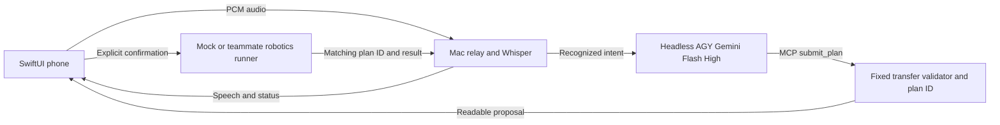

# OpenArms architecture

The current demo is a spoken mandarin transfer from A to B. Simulation is deferred. The phone shows the interpreted proposal, the student confirms, and a physical runner must obtain bench operator authorization before moving.

The current voice implementation lives under [Joseph's prototype](../research/joseph/iphone-voice-bridge/README.md). Team code ownership remains [in the README](../README.md#where-to-start). The local runner interface is documented in [INTERFACES.md](INTERFACES.md); the future team agent can replace the dialogue adapter without changing phone audio transport.

The agent interprets natural requests and can only propose a supported mandarin A-to-B transfer through `submit_plan`. Local state binds a plan ID to confirmation and one execution. Revised requests invalidate old proposals. Cancellation bypasses the model. AGY tool permission is automatic; physical motion still requires the runner's operator approval.

Logs retain session/turn/plan IDs, transcripts, planning and execution timings, controls, errors, microphone-turn WAVs, and reply WAVs. Actual MCP traces are stored separately under the local log root. The phone displays when audio is retained.

The mock runner reports simulated placement. The physical runner reports motion status and independently observed placement separately. No physical execution has been tested in this change. See [next steps and human to-do](../research/joseph/mandarin-transfer-handoff.md#next-steps).
