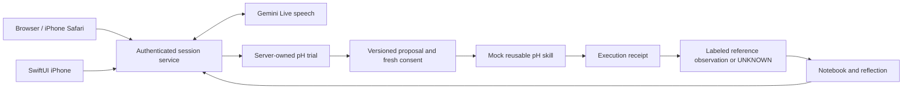

# OpenArms application architecture

OpenArms is a conversational, camera-aware, reusable-skill system demonstrated through red-cabbage pH. The complete target architecture and acceptance criteria are in [FULL_SYSTEM_DELIVERY.md](FULL_SYSTEM_DELIVERY.md). The session/trial work below is an incomplete implementation seam; it must connect to the background expert, perception tools, registry and improvement evaluation before architectural completion. The browser and native iPhone client share one authenticated application session and server-owned Gemini Live voice connection. Hardware execution is disabled in this app release.

The server owns condition selection, prediction, exact proposal, presentation, consent, execution and observation identity. The model interprets and explains. Clients own accessible rendering, microphone capture and actual audio playback acknowledgments; neither client nor model can manufacture operator permission or physical evidence.

The runtime advances one trial at a time and preserves previous trials. Successful mock execution includes automatic return to HOME. Preparing a new trial resets mock materials. Viewing history never initializes a controller. There is no hardware fallback hidden behind the mock interface.

Session access is separate from provider credentials. Clients hold only a scoped session grant. Gemini keys stay on the server. One socket owner coordinates state, text, voice, heartbeat, disconnect and recovery. Provider outages leave text available; replacement connections invalidate approvals and discard stale audio. The [interface contract](INTERFACES.md) defines messages and acceptance traces.

Historical physical evidence is preserved in [research](../research/README.md). The separate [bench runbook](WET_LAB.md) governs any future supervised pH integration. Existing mandarin transfers do not establish physical pH readiness.
