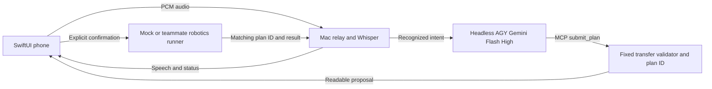
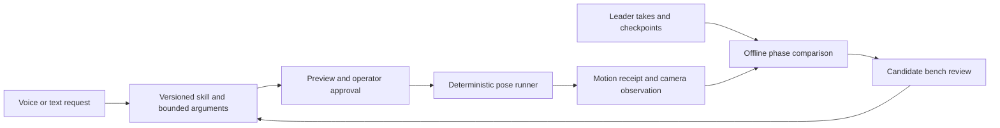

# OpenArms architecture

The existing phone demo proposes a mandarin transfer. The real arm has performed a supervised, webcam-assisted C→B transfer using an offset pickup and the taught B release. For wet-lab bring-up, the shortest physical path is a fixed-fixture water pour through the local runner. See the [wet-lab bring-up and training plan](WET_LAB.md).

The current voice implementation lives under [Joseph's prototype](../research/joseph/iphone-voice-bridge/README.md). Team code ownership remains [in the README](../README.md#where-to-start). The local runner interface is documented in [INTERFACES.md](INTERFACES.md); the future team agent can replace the dialogue adapter without changing phone audio transport.

The agent interprets natural requests and can only propose a supported mandarin A-to-B transfer through `submit_plan`. Local state binds a plan ID to confirmation and one execution. Revised requests invalidate old proposals. Cancellation bypasses the model. AGY tool permission is automatic; physical motion still requires the runner's operator approval.

Logs retain session/turn/plan IDs, transcripts, planning and execution timings, controls, errors, microphone-turn WAVs, and reply WAVs. Actual MCP traces are stored separately under the local log root. The phone displays when audio is retained.

The mock runner reports simulated placement. The physical runner reports motion status and independently observed placement separately. Physical CLI tests and the staged C→B transfer provide bench evidence. Full phone-to-physical execution remains pending.

## Physical lab and skill improvement

The local pour uses the existing `add_sample` catalog and expands one approved portion into pickup, pour, cup return, and HOME. A capture stores both the full imitation sample stream and named checkpoints. For the minimum demo, one fixed fixture and one captured take supply the whole motion. The real demo adds student choice and observed results. The stretch path combines phases across takes offline and tests candidates against the retained baseline. Changes to a cup, fixture, camera calibration, or motion require evidence specific to that configuration.

The agent can run offline comparisons without controlling the arm. It proposes motion candidates and reports their provenance. The operator supervises physical trials and confirms the lift before liquid or fruit is carried. Independently observed delivery and spill checks are recorded separately from controller completion.
