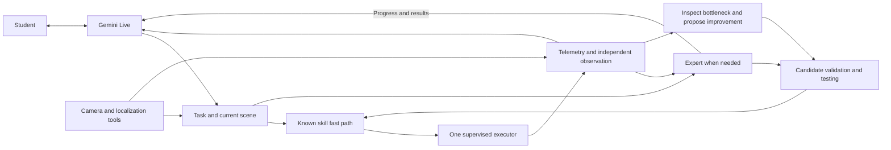

# OpenArms demo architecture

Vision revision: **demo-speed-v2**, Joseph's correction of November 14, 2026.
This is the required direction, not a claim that the implementation is complete.
[Notion product vision](https://app.notion.com/p/41871c9c107e8133aa70cf1588e620e4) owns product intent; this document translates it into the lean build contract. If they diverge, surface the conflict before changing scope.

## The demo we are building

OpenArms gives a student physical independence at a lab bench. The student speaks individual actions: “pick up cup A”, “put it down”, or a supported pour into the receiver. The student chooses the sequence. Gemini stays responsive while the arm works and reports what actually happened. Clarify ambiguous references; gently reject inappropriate actions and suggest an alternative. No experiment wizard or mandatory prediction/quiz gates. One brief optional reflection at the end is enough.

The judging proof is one narrow physical experiment: red-cabbage indicator pH. Labeled fixed stations, calibrated geometry, taught trajectories, a few specialized skills and a hardcoded physical fallback are valid choices. Simulation is backstage testing, not a replacement for the physical student experience. New-position generalization is optional if it threatens reliability.

## Priorities and acceptance

| ID | Priority | Required behavior | Evidence of delivery |
| --- | --- | --- | --- |
| D1 | P0 | Student-directed physical actions on the actual fixture | Spoken individual commands produce the requested real actions; repeat/reset and failed attempts recorded |
| D2 | P0 | Responsive Gemini conversation during work | Actual-device audio with acknowledgment, progress, clarification, cancellation and observed result; no blocking expert call in the conversation path |
| D3 | P1 | Expensive successful work becomes a reusable capability | Real expert task -> parameterized tested skill/tool -> equivalent warm request uses it without repeating unnecessary reasoning |
| D4 | P1 | One substantive measured harness improvement | Same task/setup, unchanged baseline, candidate, timings and success/failure evidence; retain or reject based on results |

Every substantial change must advance D1–D4. All other work must justify its human-time cost. D3/D4 must not destabilize the D1/D2 baseline. Their incompleteness must remain visible, not be called “everything implemented”.

## Minimum connected system

Gemini owns the conversation. The background expert gets the relevant instruction/context, timestamped scene evidence and available capabilities; it reports progress and results back. Use one working capable provider, not a provider-selection framework. Familiar operations use valid skills directly. Camera tools may be simple markers, calibrated transforms or fresh known-station checks; all-frame remote visual reasoning is not required.

The executor owns motion, bounded parameters and STOP. Existing approval/bench supervision remains in force; changing consent semantics requires an explicit interface decision. Removing educational gates does not remove physical authorization. Reject stale scene/cache assumptions and unsupported actions; controller completion alone does not prove success. The harness can propose and test new algorithms/tools offline, but that does not automatically authorize novel physical motion.

## What self-improvement means

Improve the available tools and skills, not merely names, descriptions or routing. Successful expensive work becomes compact reusable behavior. A candidate can replace repeated visual reasoning with measured geometry, improve perception, use IK, streamline calls, cache valid scene state, or optimize an execution phase. Choose the simplest change that addresses the largest measured bottleneck. Training a VLA, arbitrary manipulation and a general autonomous learning platform are not requirements.

Keep baseline -> recorded limitation -> candidate -> comparison -> retain/reject. Compare equivalent tasks and report failures/interventions, not just latency. A renamed/re-registered skill is not an improvement. Cold-to-warm savings and a subsequent implementation improvement are separate claims. Retain the physical fallback throughout.

## Speed receipt

For the same request record: completed student input, first acknowledgment, dispatch decision ready, authorization complete, first actual motion, controller finish, independent outcome available, spoken completion. Report request-to-acknowledgment, request-to-motion, planning/perception, motor duration and recovery separately. Include human approval wait rather than hiding it; also report it separately. Use repeated comparable attempts and report sample count and failures. No motor-speed increase simply to improve a latency number.

## Current implementation and evidence boundary

The product's physical target above remains open. Joseph separately authorized the full software loop with physical actuation disabled and chose the newer MuJoCo lab apparatus for its demonstration. [FULL_SYSTEM_DELIVERY](FULL_SYSTEM_DELIVERY.md) maps R1–R6; [MAIN_INTEGRATION](MAIN_INTEGRATION.md) tracks branches, evidence and release gates. Software and simulation evidence do not establish D1 physical completion.

- `agentic/openarms_lab` is the sole application task/session/registry runtime. Gemini Live owns responsive conversation; Codex gpt-6.1-sol medium performs the image-aware expert's planning and tool decisions. Known skills reuse their validated versions.
- `ui/lab` and the native SwiftUI client share authenticated sessions, exact proposals, playback acknowledgments, STOP and provenance. Prediction/reflection are optional. `/developer` shows authenticated simulation and diagnostics.
- The selected MuJoCo backend uses `simulation/lab_demos/ph`, derived from the newer titration apparatus. Position actuators drive the robot; geometric paddle engagement drives a qualitative dosing model. A separate observer reads rendered pixels. This is not contact-qualified manipulation, fluid dynamics, calibrated pH or physical success. Standalone pick/put/pour is unsupported by this backend.
- The full loop has actual Codex cold/warm evidence on this apparatus. Final integrated voice/recovery/improvement and real-device acceptance remain explicit release checks; see the evidence ledger rather than inferring completion from test counts.
- `bench_vision` supplies reusable evidence/localization tooling. `firmware/openarms_executor` preserves supervised taught actions and the successful historical mandarin trace; neither is activated implicitly by the software demo.
- `simulation/isaac` and the other MuJoCo lab videos preserve separate reproducible research. They are not alternative student experiments or another application runtime. The old `openarms_agent` research harness is not the current app entrypoint.

[Historical speed measurements and next bounded work](DEMO_SPEED.md).

## Work and review

Use [GitHub issues](https://github.com/VictorJimenez3/OpenArms/issues), existing ownership and isolated worktrees. One integrator owns shared contracts/merges; no competing runtime. Put requirement ID, owned files, dependency/consumer, baseline, acceptance evidence and exclusions in each assignment. Deliver one working connection early, not disconnected completed modules.

Before **every push**, inspect the actual diff against D1–D4 and record requirement, evidence, remaining gap and reviewer in the issue/PR or review receipt. A local receipt can precede the first branch push. A reviewer other than the implementer checks substantial changes. Tests alone cannot certify the vision; the integrator owns end-to-end proof. Do not silently reduce scope or rewrite requirements to match code. Scope changes need Joseph's explicit decision. Partial work may be pushed as a draft with gaps; it may not claim completion.
