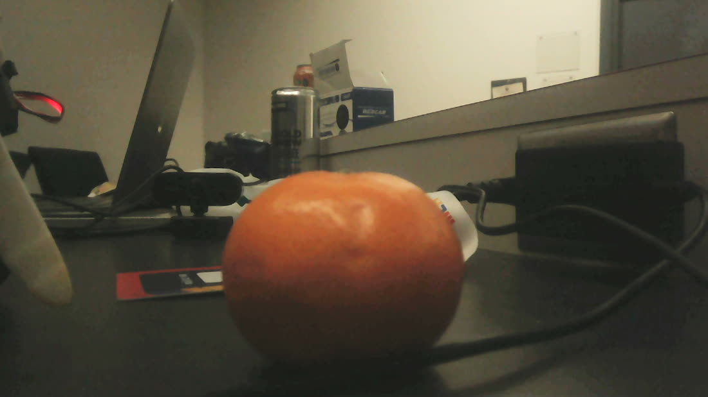
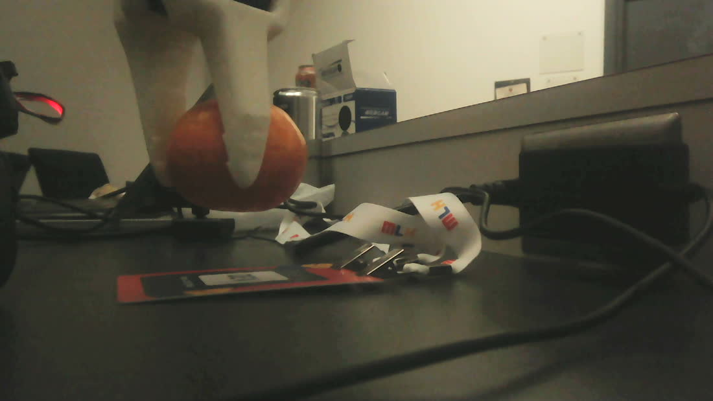
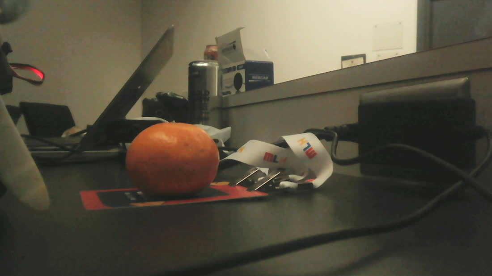

# Physical mandarin transfer on November 14

**The SO-101 physically picked up the mandarin from C, carried it to B, and released it on the red card.** Joseph supervised the MacBook session. The successful sequence ran at approximately **06:09–06:13 EST on November 14, 2026**. Both webcam views show the carry and final placement. The arm returned with about 1.3° maximum joint error from the local HOME.

| Before | Carry | After |
| --- | --- | --- |
|  |  |  |

This is one successful physical, camera-assisted transfer performed in stages. The agent interpreted webcam images and selected corrections during the run. C was not separately taught. Automatic localization, repeated success at new locations, the later packaged one-command replay, and phone-to-physical execution remain separate checks.

## Which poses were used

**The successful run loaded `outputs/mandarin-bench/bench-a.json`, preserved as [poses/bench-a.json](poses/bench-a.json).** The [historical helper](historical-source/bench-position.py.txt) explicitly loads that path. [Execution excerpts](historical-source/execution-excerpts.json) record its physical invocations. Targets in the [motion record](receipts/C-to-B-motion.json) match those checkpoints plus the corrections below.

| File | Role in this session |
| --- | --- |
| [poses.repository-baseline.json](poses/poses.repository-baseline.json) | Original tracked `firmware/openarms_executor/poses.json`, identical to repository base `1e686a5`. Earlier baseline, not the final successful transfer's input. |
| [current-home.json](poses/current-home.json) | Original repository poses with only HOME replaced. Used for the first empty replay, which stopped before B. |
| [bench-a.json](poses/bench-a.json) | Fresh A/B/HOME and gripper checkpoints from the local leader demonstration, with two requested corrections. Used by the captured A replays and successful staged C→B transfer. |
| [grasp-a-correction.json](poses/grasp-a-correction.json), [above-b-correction.json](poses/above-b-correction.json) | Retained records for the grasp-A and hover-B corrections after teaching. |

The final transfer reused the A pickup with **+5° shoulder pan**, then added a higher lift/carry: **−6.4° shoulder lift, −0.8° elbow flex, +5.3° wrist flex**. It reused the taught gripper closure, B release and HOME. These are joint-space adjustments to this bench configuration, not Cartesian offsets. Arm targets use degrees; gripper values use the configured 0–100 scale.

`bench-a.json` alone does not contain the C/lift adjustments; read it with `C-to-B-motion.json`. The continuous teaching trace is demonstration evidence. Transfer used named checkpoints and interpolated motions, not playback of every sample.

## Trial history

| Trial | Evidence | Physical result |
| --- | --- | --- |
| Earlier leader-guided A→B | Original session notes report manual leader control; no joint trace was saved for that first take. | Fruit placed on the card; distinct from the later recorded demonstration. |
| 05:35 empty replay with new HOME | [Receipt](receipts/empty-A-trial.jsonl), using `current-home.json`. | Stopped at waypoint 5 with a 4.0° shoulder-lift error; did not reach B. |
| Local A teaching | [Full trace, gzip](teaching/demo-A-0r3xmggo.jsonl.gz): 8,156 samples and eight checkpoint events over about 336 seconds. | Produced local checkpoints; two were subsequently corrected. |
| 05:50 empty local A replay | [Receipt](receipts/empty-A-captured-trial.jsonl), using `bench-a.json`; ten waypoints completed. | Operator reported good motion; gripper deliberately open. |
| 05:52 loaded local A replay | [Receipt](receipts/loaded-A-captured-trial.jsonl); ten waypoints completed. | Operator reported a missed mandarin. Controller completion did not mean transfer success. |
| Aborted C teaching | [Full trace, gzip](teaching/demo-C-s4ergxp_.jsonl.gz): 207 samples, zero checkpoint events. | No taught C pickup saved or used. |
| Unshifted grasp check | [Readings](receipts/assisted-grip-check.json); session camera review recorded fruit still on the table. | Missed pickup; B placement skipped. |
| **06:09–06:13 assisted C→B** | [Motion record](receipts/C-to-B-motion.json), [raw stage outputs](receipts/stages/), [executions](historical-source/execution-excerpts.json). | **Picked up, carried and released on the red card**, visible in [after view 0](images/after-camera-0.jpg) and [after view 1](images/after-camera-1.jpg). |

Clock times above are EST (UTC−05:00). Replay receipts record UTC; teaching `t` values are monotonic seconds. Chat metadata bounds the successful turn at 06:07:49–06:13:33. Approximate stage timing also uses preserved file modification times. Stage JSON objects have no internal wall-clock timestamps. Camera numbers identify these saved views, not stable camera identities or synchronized footage.

## Reading the retained logs

- [C-to-B-motion.json](receipts/C-to-B-motion.json) was assembled immediately after the run from six stage outputs plus the raised-lift exception. It records targets, readbacks, corrections and observed placement; it is not a continuous trajectory log.
- [Raw stage outputs](receipts/stages/) preserve hover, probe, grasp, lift, carry and drop. Raised lift stopped on a reported 3.1° shoulder error before serializing JSON. Its original empty stdout is `raise-pan5.json.empty`; the [actual exception](receipts/stages/raise-error.txt) is retained separately. Both [raised-check views](images/raised-check-camera-0.jpg) / [second view](images/raised-check-camera-1.jpg) were inspected before continuing. The later carry used a 4° arrival tolerance; other stages used 3°, with arrival nudges disabled.
- [Calibration profiles](calibration/) match the original repository base; execution excerpts show selection of that calibration directory. The base commit alone does not freeze runtime code: local edits preceded the later firmware commit.
- [The final surviving helper](historical-source/bench-position.py.txt) is archived as text. It was edited between stages and is historical evidence, not the current supported entry point or a frozen source version for every stage.
- [manifest.json](manifest.json) records sources, hashes, byte counts, compression and timing provenance. Original files are unchanged; decompression restores teaching traces exactly. Raw receipts and excerpts retain local paths as historical context, not portable links. Derived chat excerpts are labeled separately.

## Handoff to other agents

Use the observed successful C→B transfer as the physical baseline. Inspect the actual poses, actions and outcome before proposing another setup or experiment. The local `bench-a.json` differs substantially from the repository default `poses.json`; do not substitute the latter when reconstructing this run.

The later `--high-carry` option packages this approach in the maintained runner; software checks do not establish another physical replay. See the [wet-lab guide](../../../docs/WET_LAB.md#recovery-and-evidence). Mandarin C is a pickup; wet-lab C is a receiver. This fruit transfer does not establish a water pour.

Verify the bundle from this directory without connecting hardware:

```sh
shasum -a 256 -c SHA256SUMS
gzip -dc teaching/demo-A-0r3xmggo.jsonl.gz | head -n 1
```

For future trials, retain one run folder with the exact pose snapshot, code revision and local diff, calibration identifiers, command, backend, timestamped receipt, operator observation and camera evidence. Link it from the research index. Keep controller completion separate from observed placement and preserve failed attempts alongside the successful result.
