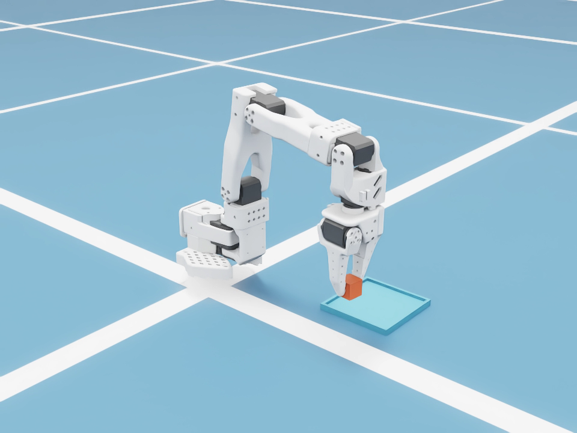

# Verified Isaac grasp-and-place and science

The white, camera-free NVIDIA SO-101 completed contact-driven grasp-and-place and
both 10 g / 40 g mass-versus-weight conditions in **Isaac 5.1.0.0** on Rutgers
**RTX A6000, Slurm job 1273420**, driver 580.178.04. Both final skills used clean
source **6afba01407b8036a0a22d5d8d6f261ac26424051** and exited zero.

- [40 g actual Isaac video](final/evidence/job-1273420-heavy-20261114T153817Z-3955121/recording/camera.mp4)
- [10 g actual Isaac video](final/evidence/job-1273420-light-20261114T153654Z-3955123/recording/camera.mp4)
- [Execution receipt and reproduction commands](final/Isaac-execution-receipt.md)
- [Science comparison](final/science-experiment/report.md)
- [Independent evidence audit](final/evidence/final-independent-review.txt)
- [Complete reviewer bundle](final/OpenArms-Isaac-evidence.zip) / [SHA256](final/OpenArms-Isaac-evidence.zip.sha256)

Each clip is 24 seconds, 720 frames, 960×720. Both final trials ran in Slurm step
1273420.2, completed 0:0. The holding allocation was deliberately cancelled after
successful steps to release the GPU. Raw logs and accounting preserve this distinction.
The measured settled tray normal forces were 0.098099999 N and 0.392399992 N;
analytic predictions are labelled separately. This is one final trial per condition,
with earlier corrected trials also retained locally; it does not establish physical
performance or broad repeatability.

The ZIP includes full raw states, both actual flattened stages, videos, startup logs,
requests/results, configuration, receipts, upstream notices, and a source Git bundle
at the exact execution commit. Large raw states/stages are inside the archive rather
than duplicated as loose Git files. Extract the ZIP before running the report audit.
Receipts retain original machine paths. The receipt's historical-failure references
point to the fuller original local evidence collection and are not all in this ZIP.

The temporary RTX 3060 VM was removed; original host driver 595.99.02 and desktop
services were restored, and all 18 task-installed VM packages removed. Restoration
proof is included. No host driver replacement or reboot was performed.

[Earlier failed articulation runs](earlier-articulation.md) remain preserved.
Their old status text is historical and is superseded by the qualified runs above.
The [runtime runbook](../README.md) describes the simulation-only process interface;
application backend registration remains an integrator task.
