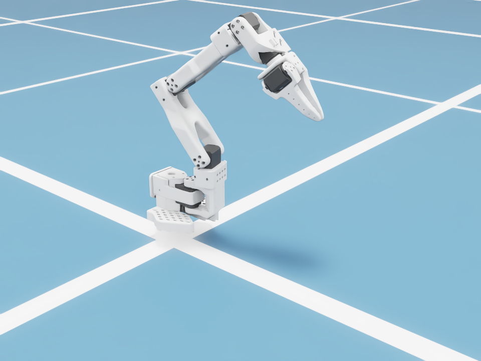

# Actual Isaac recording, with preserved failure

[Open the white, camera-free SO-101 video](job-1273070/smoke/camera.mp4).

This is authentic Isaac Sim 5.1.0.0 footage, not a Blender animation. It proves
robot rendering and measured articulation only. **No grasp/place or science
experiment has passed.** The recording finished, then Isaac aborted during
stage cleanup; overall execution failed.

- Execution source: `2cb3088fd9c424862ba181942c479de818515907`, clean checkout.
- Slurm job: `1273070`, rlab7.cs.rutgers.edu, November 14, 2026, 09:22–09:23 Eastern.
- GPU: RTX A6000, UUID `GPU-4babf9c9-e407-94af-2692-64cb190c9826`, driver 580.178.04.
- Isaac distribution: 5.1.0.0; workshop pin `ce807d99724cb65671abec01f908a2fcb4a6eab7`.
- Scene: upstream NO-CAMERA articulation, white printed plastic, fixed base,
  ground plane, dome light, external evidence camera. Physics 120 Hz, video 30 Hz.
- Result: 240 H264 frames, 960×720, 8 seconds; measured Rotation span 0.3613 rad.
- Native exit: `-6` (abort); wrapper/job exit: 1.

The [receipt](job-1273070/smoke/receipt.json),
[process result](job-1273070/smoke/execution.json),
[raw log](job-1273070/startup.log), and
[measured states](job-1273070/smoke/state.jsonl) preserve that distinction.
Video SHA256: `77cc36b1f5fdbbefd748664109a600f049d052d07126964fc9aa1ed725d4ee87`.

The 187 MB flattened `scene.usda` is retained in the original shared evidence at
`/common/users/jdr317/openarms-isaac/evidence/job-1273070/smoke/scene.usda` rather
than duplicated in Git. Its SHA256 is
`c3472208db0fcf9da823bace2d0d7d44ba2a8d5041e1339d1270f97ae8dfd8d2`.
The [runbook](../README.md) reconstructs the same stage from pinned assets.
For exact reproduction, check out the execution source above and submit
`runtime_job.sh` through Slurm with one A6000 on rlab7, 32 GB RAM and 30 minutes.
Every new process creates/resets its own stage and writes a new evidence folder.
This reset implementation still needs a successful repeated manipulation test.

The rendered robot comes from NVIDIA's Apache-2.0
[SO-101 workshop](https://github.com/isaac-sim/Sim-to-Real-SO-101-Workshop/tree/ce807d99724cb65671abec01f908a2fcb4a6eab7).
Original upstream notices remain with the downloaded assets.
